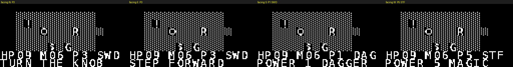

# cabnetBoy Rogue — 노브 & 슬라이더로 하는 CH32V003 턴제 로그라이크

CH32V003A4M6 (16 KB Flash / 2 KB SRAM) 에서 도는 **턴제 그리드 로그라이크**입니다.
이 보드의 아날로그 입력 2개(로타리 노브, 슬라이더)를 게임의 핵심 조작으로 씁니다.

```
RAM:   532 / 2048 bytes  (26.0%)
Flash: 7452 / 16384 bytes (45.5%)     ← 기존 Arkanoid 펌웨어는 13588 (82.9%)
```

---

## 0. ⚠️ 먼저 읽어야 할 것 — 슬라이더가 지금 하드웨어에서 동작하지 않습니다

**결론(회로도 + PCB 동박 데이터 양쪽으로 확인):** U5(B10K 슬라이더)는 **와이퍼가 VCC에 묶여 있고,
ADC 입력은 트랙 반대쪽 끝에 붙어 있습니다.** 이 상태에서는

1. ADC(PD6) 값이 **슬라이더 위치와 무관하게 항상 VCC(≈1023)** 로 읽힙니다 → 파워 조절 불가
2. 슬라이더를 GND 쪽 끝까지 밀면 **VCC–GND가 와이퍼 접점만으로 단락**됩니다 → 트랙/배터리 손상 위험

### 확인한 실제 연결 (PCB 동박에서 추출)

| U5 패드 위치 (mm) | 실크 | 실제 네트 | 있어야 할 것 |
|---|---|---|---|
| (32.99, −5.53) | 1 | **GND** | GND ✅ |
| (35.59, −5.53) | 1 | **GND** | GND ✅ |
| (32.99, −30.03) | 2 | **VCC** | ← 여기가 **R_Slider(와이퍼)** 여야 함 ❌ |
| (35.59, −30.03) | 3 | **R_Slider → PD6** | ← 여기가 **VCC** 여야 함 ❌ |

회로도에서도 동일합니다: `GND→U5.1`, `VCC→U5.2(와이퍼)`, `R_Slider→U5.3`.

트랙의 **끝**에 ADC를 붙이면, 와이퍼에서 그 끝까지는 전류가 흐르지 않으므로
ADC는 항상 와이퍼 전압(=VCC)을 읽습니다. **와이퍼가 ADC로 가야만** 값이 변합니다.

### 고치는 방법 A — 기존 PCB를 개조 (컷 2 + 점퍼 2)

U5 아래쪽 패드 2개(실크 `2`, `3`)를 대상으로:

1. **2번 패드(왼쪽)의 VCC 배선을 컷**
2. **3번 패드(오른쪽)에서 PD6로 가는 배선을 컷**
3. **2번 패드 → 컷한 3번 쪽 배선(PD6 방향)으로 점퍼**
4. **3번 패드 → VCC로 점퍼** (바로 왼쪽 (30.48, −29.21) mm 부근에 VCC 비아가 있습니다)

결과: `1=GND`, `2(와이퍼)=R_Slider→PD6`, `3=VCC` → 정상 전압분배기, 단락 위험도 사라집니다.

### 고치는 방법 B — PCB 리스핀

EasyEDA에서 **U5 풋프린트의 네트만** 바꾸면 됩니다:
`VCC → U5.2` 를 `VCC → U5.3` 으로, `R_Slider → U5.3` 을 `R_Slider → U5.2` 로.
(회로도 심볼 배선도 함께 수정 → PCB 업데이트)

### 수정 전에도 게임은 돌아갑니다

펌웨어가 부팅 시 슬라이더가 레일에 붙어 있는지 검사해서, 붙어 있으면
`SLIDER DEAD: FIX U5` 를 띄우고 **DOWN 버튼으로 파워를 1→5 순환**하는 폴백으로 자동 전환합니다.
(슬라이더가 정상이면 DOWN은 "한 턴 대기" 로 동작합니다.)

> 참고: **RV09 로타리(HANDLER)는 정상 배선입니다.** PCB에서 `1=GND`, `2=와이퍼→R_Rotate→PD4`,
> `3=VCC` 로 확인됐습니다. 그래서 노브는 바로 쓸 수 있습니다.

---

## 1. 조작 (요청하신 구성)

| 입력 | 동작 |
|---|---|
| **RV09 노브** (PD4, ADC7) | **캐릭터 회전** — 나침반처럼 돌려서 방향 결정 (0=N 1=E 2=S 3=W) |
| **U5 슬라이더** (PD6, ADC6) | **파워 / 마법 세기** 1~5 (연속 읽기, 턴 소모 없음) |
| **LEFT** | **무기 / 아이템 셀렉트** 순환 — `DAG` `SWD` `AXE` `STF` `POT` |
| **ACT** | **공격 / 마법 / 아이템 사용** (발밑에 아이템이 있으면 줍기, 계단이면 내려가기) |
| **UP** | 앞으로 한 칸 전진 (몬스터가 있으면 그대로 공격) |
| **DOWN** | 한 턴 대기 *(슬라이더 고장 시 파워 순환)* |

**노브 회전과 슬라이더 이동은 턴을 소모하지 않습니다.** 조준하고 세기를 맞춘 뒤
UP/ACT로 실행하는 구조라, 두 아날로그 입력이 "매 턴의 판단"에 직접 들어옵니다.

### 방향 표시
`@` 를 방향별로 4종 준비했습니다. 노브를 돌리면 `@` 의 **돌기 위치가 바뀝니다**.


---

## 2. 무기 / 마법 밸런스 (슬라이더가 의미를 갖도록)

파워 `P` 는 슬라이더 값(0~255)을 5단계로 나눈 값입니다.

| 슬롯 | 이름 | 동작 | 데미지 | 비용 |
|---|---|---|---|---|
| `DAG` | 단검 | 근접 (앞 칸) | `2 + P/2` → 2~4 | 없음 |
| `SWD` | 검 | 근접 | `3 + P` → 4~8 | 없음 |
| `AXE` | 도끼 | 근접 | `4 + 2P` → 6~14 | **P ≥ 3 필요** (아니면 "AXE TOO HEAVY") |
| `STF` | 지팡이 | **원거리 마법** | `2P` → 2~10 | **MP = P**, 사거리 `1+P` 칸 |
| `POT` | 포션 | 회복 | HP +6, MP +3 | 보유 개수 소모 |

- MP 최대 10, 4턴마다 1씩 회복. 포션은 바닥에서 주워서 비축합니다.
- **도끼는 슬라이더를 올려야 쓸 수 있고, 지팡이는 슬라이더를 올릴수록 강해지지만 MP를 그만큼 먹습니다.**
  → "싸게 때릴까, 크게 쓸까"를 매 턴 슬라이더로 고르게 됩니다.
- 마법은 **노브로 정한 방향**으로 날아가 벽에 막힙니다 → 노브와 슬라이더가 같이 쓰입니다.

### HUD
```
HP09 M06 P3 SWD      ← 체력 / 마나 / 파워 / 무기
STEP FORWARD         ← 메시지
```



---

## 3. 나머지 게임 규칙 (마일스톤 1)

- **던전**: 32×16 타일, 방 4개 + L자 복도, **2비트/타일**(128 B)
- **시야**: 반경 7, Bresenham 라인으로 벽 차단 판정. 지나간 곳은 `seen` 에 남아 지형만 유지
- **몬스터 4종**: R(쥐) G(고블린) S(뱀) O(오크) — 보이는 동안만 접근, 인접 시 공격
- **아이템**: `!` 포션, `$` 골드 / **계단** `>` 에서 ACT → 다음 층(깊이+1, HP+3)
- **턴 루프**: `입력 대기 → 행동 → 몬스터 턴 → 시야 재계산 → 렌더`

---

## 4. 하드웨어 제약과 설계 결정

| 항목 | 값 | 설계에 미친 영향 |
|---|---|---|
| Flash 16 KB | 현재 7,452 B 사용 | 폰트 512 B + 타일 64 B, 나머지는 게임/드라이버 |
| SRAM 2 KB | 현재 532 B 사용 | **프레임버퍼 없음** — 128 B 페이지 1장만 스트리밍 |
| RV32EC | FPU·하드웨어 곱/나눗셈 없음 | **정수 연산만** (기존 Arkanoid의 `float` 은 제거) |
| I2C 400 kHz | 전화면 ≈ 24 ms | 턴제라 매 턴 전화면 재생성으로 충분 |
| 노브 | 0~1023 비율식 | 4샘플 평균 + 자동 범위 보정으로 4섹터 |
| 슬라이더 | 0~255 | 5단계 파워 (수정 후) |

**렌더러 원리**: SSD1306은 8픽셀 페이지 8장이고 8×8 타일은 정확히 페이지 1장 안의
가로 8픽셀이라, `gfx_begin(page) → gfx_cell(col, value) → gfx_send()` 로 128 B씩
전송합니다. 행 단위 타일/글리프를 그릴 때 8×8 비트 전치만 합니다.

**폰트**: DejaVu Sans Mono(자유 라이선스) 11px를 8×8로 래스터라이즈해 자동 생성
(`_work/gen_font8.py`). ASCII 32~95만 저장(512 B)하고 소문자는 대문자로 폅니다.

---

## 5. 파일 구조

```
software/cabnetBoyRogue/
├── platformio.ini
├── ld/ch32v003.ld
└── src/
    ├── ch32v003.h  system.c/.h  gpio.h  i2c_tx.c/.h  oled_min.c/.h   (공용 드라이버)
    ├── retro.h / retro.c    보드 계층: 핀, 래더 입력, 부저, RNG
    ├── gfx.h   / gfx.c      렌더러: 8×8 셀 → SSD1306 페이지 스트리밍
    ├── font8.h              8×8 폰트 (자동 생성, 512 B)
    ├── tiles.h              8×8 타일 8개 (지형 4 + 방향별 @ 4)
    ├── game.h  / game.c     노브/슬라이더 입력, 턴 루프, 전투, 마법, 던전
    └── main.c
```

---

## 6. 빌드 / 확인

```powershell
$pio = "$env:USERPROFILE\.platformio\penv\Scripts\pio.exe"
cd software\cabnetBoyRogue
& $pio run                    # 빌드 + 용량 확인 (검증됨)
& $pio run -t upload          # WCH-LinkE 로 굽기
```

**노브가 안 먹을 때**: `software/calibrator` 로 PD4 값을 보면서 실제 가동 범위를 확인하세요.
게임은 자동 범위 보정(span ≥ 90 이면 재매핑)을 하므로 대부분 그대로 동작합니다.

**호스트 미리보기** (`_work/`, C 소스의 폰트·타일을 직접 파싱):
- `rogue_preview.py` — 랜덤 던전 렌더
- `rogue_facing.py` — 4방향 + HUD/파워 표시
- `rogue_dump.py` — 셀 코드 문자 덤프(논리 검증)

---

## 7. 다음 단계

| M | 내용 |
|---|---|
| **M1** | 지금 상태. **U5 개조 먼저** → 노브+슬라이더 감각 확인 |
| M2 | 무기별 고유 효과(도끼 광역, 지팡이 관통), 방어구, 3줄 로그, 층 테마 |
| M3 | EEPROM(HT24LC64) 세이브·하이스코어 — **WP(7) 플로팅을 GND로 수정한 뒤** |
| M4 | 부저 BGM, 피격 플래시(`OLED_INVERT`), 화면 흔들림 |
| M5 | 상점, 보스, 시드 공유, 슬라이더로 마법 속성 선택 |

---

## 8. 참고 — 기존 `software/cabnetBoy` 코드 리뷰 요약

Arkanoid 포팅이며, 로그라이크와 무관하지만 **같은 하드웨어를 쓰므로 버그는 참고**하세요.

1. `driver.h:83-101` **ADC 채널 복원 누락** — 슬라이더/노브를 읽은 뒤 방향키가 그 채널을 계속 읽음 (현재는 미호출이라 잠복)
2. `driver.h:33` **DOWN 인식 불가** — 래더 계산상 DOWN = ADC 347 인데 `JOY_S=300`, `JOY_DEV=20` → 280~320만 통과
3. `driver.h:31,34,36` **RIGHT 없음** — `JOY_E/NE/SE` 는 8방향 조이스틱 값
4. `main.c:252`, `spritebank.h:35-42` **float 사용** — RV32EC라 소프트플로트
5. `main.c:394` 초기화 안 된 `Frame` 사용, `main.c:347-369` 렌더가 전역 상태 의존,
   `main.c:313` unsigned 비교로 죽은 코드, `i2c_tx.c:59-64` 무한 대기 + 워치독 없음
