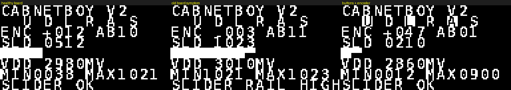

# cabnetBoy v2 — 하드웨어 자가진단 펌웨어

새로 만든 보드에 **게임을 굽기 전에 먼저 굽는** 테스트 펌웨어입니다.
모든 입력을 실시간으로 보여주고, 배선 오류를 화면과 부저로 알려줍니다.

```
RAM:   296 / 2048 bytes  (14.5%)
Flash: 3880 / 16384 bytes (23.7%)
```



*(왼쪽부터: 정상 보드 / 구보드에서 실제로 나던 증상 / 버튼+엔코더 입력 중)*

---

## 화면 구성

| 행 | 표시 | 설명 |
|---|---|---|
| 0 | `CABNETBOY V2` | 타이틀 |
| 1 | `U D L R A S` | 누른 버튼이 **반전(흰 블록)** 으로 표시 |
| 2 | `ENC +012 AB10` | 엔코더 디텐트 누적값(±) + A/B 핀 원시 상태 |
| 3 | `SLD 0512` | 슬라이더 ADC 원시값 (0~1023) |
| 4 | 16칸 바 | 슬라이더 위치 시각화 |
| 5 | `VDD 2980MV` | 공급 전압 (내부 1.2 V 레퍼런스로 측정) |
| 6 | `MIN0038 MAX1021` | 지금까지 관측한 슬라이더 최소/최대 |
| 7 | 판정 | 아래 참조 |

### 판정(7행)이 잡아주는 것

| 표시 | 의미 |
|---|---|
| `SLIDER RAIL HIGH` | 슬라이더가 1021~1023에 고정 → **VCC가 와이퍼에 붙은 배선**(구보드의 버그) |
| `SLIDER RAIL LOW!` | 0~8에 고정 → 트랙 한쪽이 GND에 단락 |
| `SLIDER OK` | min~max 폭이 8 이상 → 정상 |
| `MOVE THE SLIDER` | 아직 안 움직임 (판정 보류) |
| `OLED NOT FOUND!` | I2C 무응답 (NACK/타임아웃) |
| `BTN STUCK AT BOOT` | 부팅 시 눌린 채였던 버튼이 계속 눌림 → 쇼트/풋프린트 오류 |
| `LOW BATTERY` | VDD < 2.7 V |

### 부저로도 알려줍니다
- **버튼을 누를 때마다 짧은 비프** → 부저 동작을 따로 테스트할 필요 없음
- **OLED가 응답하지 않으면** 화면에 아무것도 못 쓰므로, **짧은 고음 3번 + 쉼** 패턴을 반복하며
  700 ms마다 버스를 다시 확인합니다. OLED를 나중에 꽂아도 자동으로 화면이 살아납니다.

---

## 핀맵 (새 보드 기준)

`src/hw.h` **한 파일만** 고치면 핀맵이 바뀝니다.

| SOP16 | 신호 | 기능 |
|---|---|---|
| 1 | PC1 | I2C SDA (OLED, 4k7 풀업) |
| 2 | PC2 | I2C SCL (OLED, 4k7 풀업) |
| 3 | PC3 | BTN_UP |
| 4 | PC4 | BTN_DOWN |
| 5 | PC6 | BTN_LEFT |
| 6 | PC7 | BTN_RIGHT |
| 7 | PD1 | DIO / SWIO (디버그, 부하 금지) |
| 8 | PD4 | ENC_A (EC11) |
| 9 | PD5 | ENC_B (EC11) |
| 10 | PD6 | SLIDER (U5 B10K **와이퍼**, ADC6) |
| 11 | PD7 | NRST (리셋 택트 + 100nF) |
| 12 | PA1 | ENC_SW (엔코더 누름 = SELECT) |
| 13 | PA2 | BEEP (PNP, 1k + 10k 풀업) |
| 14 | VSS | GND |
| 15 | VDD | VCC |
| 16 | PC0 | BTN_ACT |

---

## 빌드 / 굽기

```powershell
$pio = "$env:USERPROFILE\.platformio\penv\Scripts\pio.exe"
cd software\cabnetBoyTest
& $pio run                 # 빌드 (검증됨, 경고 0)
& $pio run -t upload       # WCH-LinkE
```

## 첫 전원 투입 순서

1. **전원만 넣고 전류 확인** (단락 여부)
2. 이 자가진단 펌웨어 굽기
3. 화면이 뜨면 → **버튼 6개를 하나씩 눌러** 1행이 반전되는지 + 비프가 나는지 확인
4. **슬라이더를 양 끝까지** 움직여 `MIN/MAX` 폭이 1000 이상, 7행이 `SLIDER OK` 인지 확인
5. **엔코더를 시계방향으로** 돌려 `ENC` 값이 증가하는지 확인
   (반대로 움직이면 `ENC_DIV` 조정 또는 A/B를 바꾸면 됩니다. 증감 부호는 게임 펌웨어에서 뒤집을 수 있습니다)
   - 한 클릭에 2씩 움직이면 `hw.h` 의 `ENC_DIV` 를 2로
6. `VDD` 가 2.9 V 이상인지 확인 (낮으면 배터리/부저 전류 문제)
7. 위가 모두 통과하면 게임 펌웨어(`cabnetBoyRogue`) 굽기

---

## 이 펌웨어에 들어간 개선점 (공용 드라이버 대비)

| 파일 | 변경 | 이유 |
|---|---|---|
| `i2c_tx.c` | 모든 대기에 **타임아웃**, 주소 **NACK 감지**, `I2C_recover()` | OLED 없이 전원을 넣어도 펌웨어가 멈추지 않음 (원본은 무한 대기) |
| `gfx.c` | I2C 오류 시 전송 생략, `gfx_cell_inv()`, `gfx_bar()` 추가 | 오류 상태에서 프레임마다 1024번 타임아웃되는 것 방지 |
| `hw.c` | 4방향+ACT+SEL 개별 읽기, **엔코더 그레이코드 상태표**, 슬라이더 채널 재선택 | ADC 채널 공유 버그 원천 차단 |
| `test.c` | 판정 로직 + 부저 진단 | 벤치에서 배선 검증 |

---

## 다음 단계

자가진단이 통과하면 게임 펌웨어를 이 핀맵으로 옮기면 됩니다:
- 4방향 버튼 = 직접 이동/공격 (회전+전진 방식 제거)
- 엔코더 = 마법 조준 (또는 캐릭터 회전 — 취향)
- 엔코더 누름(SEL) = 무기/아이템 셀렉트
- 슬라이더 = 파워/마법 세기 (기존 로직 그대로)
